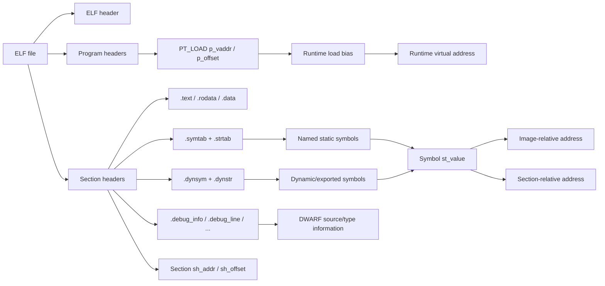
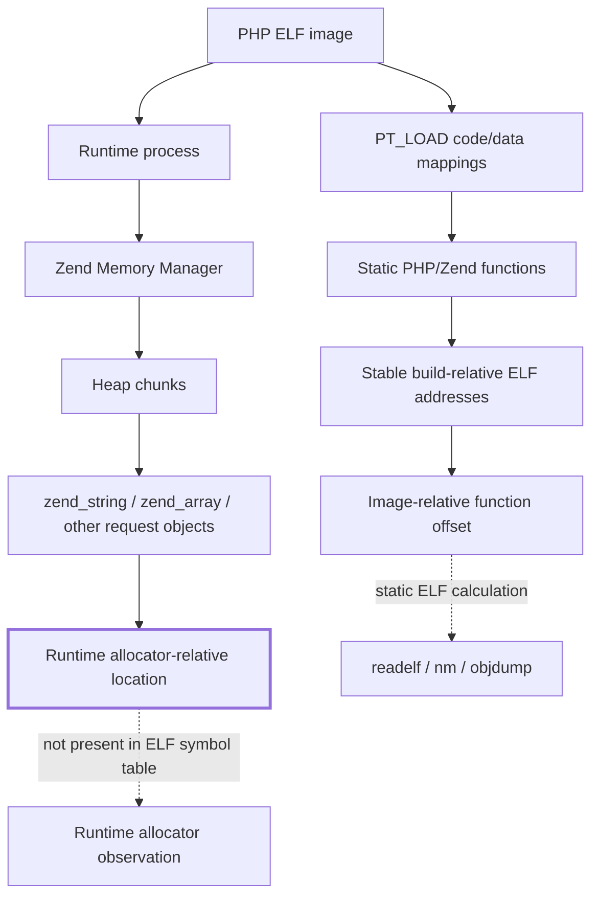
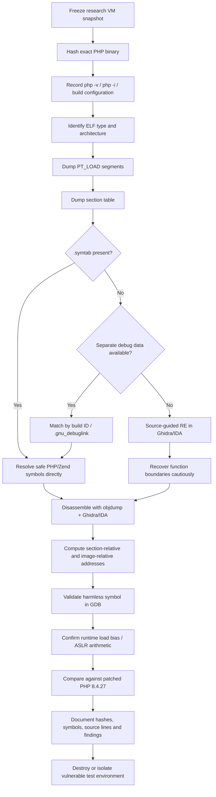

# Defensive Analysis of a PHP 8.4.25 Ubuntu ELF Build: Symbols, Sections, Debug Information, and Runtime Address Validation

## Executive summary

PHP **8.4.25**, released on August 27, 2026, is now an obsolete and security-sensitive research target. On October 21, 2026, the PHP project released **8.4.27** to fix two critical vulnerabilities, CVE-2026-109618 and CVE-2026-109619. Both official advisories identify versions **earlier than 8.4.27** as affected, and the PHP project states that updating is the only complete mitigation. The advisories describe use-after-free/stale-state conditions capable of unauthenticated remote code execution under affected configurations. citeturn12view2turn13view0turn12view1

That disclosure changes the security context of the terms in your question. `ZIF_OFFSET`, `DTOR_OFFSET`, and `HTDATA_OFFSET`/`HDATA_OFFSET` are **not standard PHP build-system names or ELF concepts**. They are names currently used in public PHP2Shell exploit-calibration material. In particular, public material associates the first two with internal PHP/Zend functions and the third with a heap-relative object used during exploitation. PHP's own source confirms the underlying mechanisms: `ZEND_FUNCTION(name)` produces a C symbol named `zif_<name>`, `zval_ptr_dtor()` exists as an exported Zend API function, and Zend hash tables accept a `pDestructor` callback. citeturn8view0turn8view1turn8view2

Because deriving the **exact three exploit-calibration constants for a vulnerable PHP 8.4.25 image** would directly adapt a presently disclosed RCE chain to a specific build, this report does **not** provide final values, a script that emits those three constants, or the exploit-specific heap-carrier search needed for `HTDATA_OFFSET`. It does provide the rigorous defensive reverse-engineering workflow you requested: complete artifact preservation; `readelf`, `nm`, `objdump`, and `strings` commands; ELF address mathematics; stripped-versus-unstripped analysis; separate DWARF handling; Ghidra/IDA methodology; and runtime verification using harmless PHP/Zend symbols. The same ELF mathematics is suitable for legitimate crash triage, symbolization, binary provenance analysis, patch comparison, and vulnerability root-cause work without turning the vulnerable build into an exploit profile. GNU's ELF tools explicitly expose ELF headers, sections, symbols and disassembly for these purposes, while GDB supports separate debug files through `.gnu_debuglink` and build IDs. citeturn3search0turn3search34turn11search1

A second important distinction is that **an ELF function offset and a heap-layout offset are fundamentally different quantities**. A function's symbol value can usually be related deterministically to an ELF image or section. A heap object's address is created at runtime by the allocator and is not described by `.symtab`, `.dynsym`, `.text`, or the ELF program headers. Consequently, an `HTDATA_OFFSET` referring to a live Zend-MM allocation cannot legitimately be obtained by simply subtracting a `.data` or `.text` section base. The official PHP security advisories themselves emphasize that exploitation reliability depends on the PHP build, extensions, frontend behavior, and allocator layout. citeturn13view0

> **Assumption used below:** by “configured with php-cli and php-debug” I interpret your build as `--enable-cli --enable-debug`. `--enable-debug` means PHP is compiled with debugging support/symbols; it is not the same thing as the separate `phpdbg` SAPI. PHP's documentation explicitly defines `--enable-debug` as compiling with debugging symbols and recommends debug builds for development. citeturn4search0turn4search9

## Establish the exact build before examining offsets

Every address result should first be bound to a cryptographic identity and build configuration. This matters especially for PHP 8.4.25 because compiler version, optimization, LTO, PIE, enabled extensions, link order, `--enable-debug`, source changes, and stripping can all change symbol placement. The PHP advisory independently notes that exploit portability and reliability vary with the PHP build and allocator layout. citeturn13view0

Assume the binary under investigation is the locally built CLI executable:

```bash
export PHPBIN=/absolute/path/to/php-src/sapi/cli/php
export OUT="$PWD/php-8.4.25-analysis"

mkdir -p "$OUT"

test -x "$PHPBIN" || {
    echo "ERROR: PHPBIN does not point to an executable" >&2
    exit 1
}

readlink -f "$PHPBIN" | tee "$OUT/php.path.txt"
sha256sum "$PHPBIN" | tee "$OUT/php.sha256"
stat "$PHPBIN"       > "$OUT/php.stat.txt"
file "$PHPBIN"       | tee "$OUT/php.file.txt"

"$PHPBIN" -n -v      | tee "$OUT/php.version.txt"
"$PHPBIN" -n -i      > "$OUT/php.info.txt"
"$PHPBIN" -n -m      > "$OUT/php.modules.txt"
```

`-n` is useful during binary research because it instructs CLI PHP not to use the normal `php.ini`, reducing environmental variability. The important artifact is the **binary SHA-256**: all subsequent findings should be recorded against that exact digest rather than merely “PHP 8.4.25.”

If you still have the source/build directory, preserve its configuration artifacts before cleaning or rebuilding it:

```bash
export SRCDIR=/absolute/path/to/php-src

for f in \
    config.nice \
    config.log \
    config.status \
    Makefile \
    main/build-defs.h
do
    if [ -f "$SRCDIR/$f" ]; then
        cp -a "$SRCDIR/$f" "$OUT/"
    fi
done

if [ -x "$SRCDIR/scripts/php-config" ]; then
    "$SRCDIR/scripts/php-config" --configure-options \
        > "$OUT/configure-options.txt" 2>&1 || true
fi

grep -E '^(CFLAGS|CXXFLAGS|LDFLAGS|EXTRA_LDFLAGS|CONFIGURE_COMMAND)' \
    "$SRCDIR/Makefile" "$SRCDIR/main/build-defs.h" 2>/dev/null \
    > "$OUT/build-flags.txt" || true
```

The original `config.nice` is especially valuable because PHP's source build process is driven by `configure`, and the official PHP documentation recommends consulting `./configure --help` for the complete option set. `--enable-debug` is specifically documented as a request to compile debugging support/symbols. citeturn4search0turn4search9

Record toolchain information as well:

```bash
{
    gcc --version 2>/dev/null | head -1
    clang --version 2>/dev/null | head -1
    ld --version 2>/dev/null | head -1
    readelf --version 2>/dev/null | head -1
    objdump --version 2>/dev/null | head -1
    gdb --version 2>/dev/null | head -1
} > "$OUT/toolchain.txt"

readelf -p .comment "$PHPBIN" > "$OUT/elf.comment.txt" 2>&1 || true
```

Then create a full ELF inventory:

```bash
readelf -hW "$PHPBIN" > "$OUT/readelf.header.txt"
readelf -lW "$PHPBIN" > "$OUT/readelf.program-headers.txt"
readelf -SW "$PHPBIN" > "$OUT/readelf.sections.txt"
readelf -sW "$PHPBIN" > "$OUT/readelf.symbols.txt"
readelf -dW "$PHPBIN" > "$OUT/readelf.dynamic.txt"
readelf -nW "$PHPBIN" > "$OUT/readelf.notes.txt"
readelf -rW "$PHPBIN" > "$OUT/readelf.relocations.txt"

nm -an "$PHPBIN"       > "$OUT/nm.all.txt"      2>&1 || true
nm -anD "$PHPBIN"      > "$OUT/nm.dynamic.txt"  2>&1 || true

objdump -x "$PHPBIN"   > "$OUT/objdump.x.txt"
objdump -h "$PHPBIN"   > "$OUT/objdump.sections.txt"
objdump -t "$PHPBIN"   > "$OUT/objdump.symtab.txt" 2>&1 || true
objdump -T "$PHPBIN"   > "$OUT/objdump.dynsym.txt" 2>&1 || true

strings -a -t x "$PHPBIN" > "$OUT/strings.hex-offsets.txt"
```

`readelf` operates directly on ELF structures; `nm` reports symbol values and symbol types; `objdump -d` disassembles sections expected to contain instructions; and GNU `strings` can report printable strings, optionally with file offsets. citeturn3search5turn3search0turn5search2

A concise first-pass inspection is:

```bash
printf '\n== ELF type / architecture ==\n'
readelf -hW "$PHPBIN" | grep -E 'Class:|Data:|Type:|Machine:|Entry point'

printf '\n== LOAD segments ==\n'
readelf -lW "$PHPBIN" | grep -E '^[[:space:]]*LOAD'

printf '\n== Symbols/debug sections ==\n'
readelf -SW "$PHPBIN" |
    grep -E '\.symtab|\.strtab|\.dynsym|\.dynstr|\.debug_|\.zdebug_|\.gnu_debuglink|\.note\.gnu\.build-id'
```

An illustrative debug build might resemble:

```text
Class:                             ELF64
Type:                              DYN (Position-Independent Executable file)
Machine:                           Advanced Micro Devices X86-64

[ 6] .dynsym            DYNSYM
[30] .debug_info        PROGBITS
[31] .debug_abbrev      PROGBITS
[32] .debug_line        PROGBITS
[36] .symtab            SYMTAB
[37] .strtab            STRTAB
```

That output is only an example. Your SHA-256-bound binary is authoritative.

The relationship to keep in mind is:



ELF deliberately has both a linking/section view and an execution/segment view; GNU tools expose both, and an ELF symbol's `st_value` must therefore be interpreted in the context of the object's ELF type and load layout rather than being treated blindly as a raw file offset. citeturn3search34turn3search0

## Symbol and section analysis

### Determine whether the executable is PIE

Run:

```bash
readelf -hW "$PHPBIN" | grep 'Type:'
readelf -lW "$PHPBIN" | grep -E '^[[:space:]]*LOAD'
```

Common cases are:

```text
Type: DYN (Position-Independent Executable file)
```

or:

```text
Type: EXEC (Executable file)
```

For a PIE executable, the ELF file is normally `ET_DYN`. Linux chooses a runtime load bias because of ASLR. The static `st_value` remains useful as an image-relative virtual address; the runtime address is obtained by adding the load bias. For a conventional non-PIE `ET_EXEC`, symbols normally carry their fixed linked virtual addresses, so an explicit subtraction from the image's lowest load virtual address is needed when you want an RVA-like quantity. ELF program headers, rather than `.text` alone, are the correct foundation for reconstructing the runtime image. citeturn3search34turn3search0

### Inspect ordinary PHP `zif_` symbols without targeting the RCE sink

PHP's own source makes the naming rule explicit:

```c
#define ZEND_FN(name) zif_##name
#define ZEND_FUNCTION(name) ZEND_NAMED_FUNCTION(zif_##name)
```

so a normal built-in PHP function implemented with `PHP_FUNCTION()`/`ZEND_FUNCTION()` becomes a native symbol beginning with `zif_`. citeturn8view0

Use a benign exemplar such as `zif_phpversion` or another innocuous `zif_*` symbol present in your build:

```bash
nm -an "$PHPBIN" |
    grep -E '[[:space:]]zif_[[:alnum:]_]+' |
    head -40
```

or:

```bash
readelf -sW "$PHPBIN" |
    grep -E '[[:space:]]zif_[[:alnum:]_]+' |
    head -40
```

Expected shape:

```text
00000000001abc20 t zif_example
00000000001ac0e0 t zif_example2
```

The hexadecimal field is the symbol value. GNU `nm` documents that it reports the symbol value, symbol type, and symbol name. Lower-case `t` conventionally indicates a local text/code symbol, while upper-case `T` indicates a global text symbol. citeturn3search5

Cross-check one chosen harmless symbol:

```bash
export SAFE_SYMBOL=zif_phpversion

nm -an "$PHPBIN" | grep -w "$SAFE_SYMBOL" || true
readelf -sW "$PHPBIN" | grep -w "$SAFE_SYMBOL" || true
objdump -t "$PHPBIN" | grep -w "$SAFE_SYMBOL" || true
```

If all three resolve the same address, you have independent confirmation from different Binutils frontends.

### Determine the containing section

Suppose `readelf -sW` produces:

```text
1234: 0000000000123450   115 FUNC LOCAL DEFAULT 15 zif_phpversion
```

The `15` is the section index. Retrieve section 15:

```bash
readelf -SW "$PHPBIN" | sed -n '/\[ *15\]/p'
```

Illustratively:

```text
[15] .text PROGBITS 0000000000049000 049000 ...
```

Then:

\[
\text{section-relative offset}
  = \text{symbol st\_value}
  - \text{section sh\_addr}
\]

For purely illustrative addresses:

```text
symbol st_value     = 0x00123450
.text sh_addr       = 0x00049000

section offset      = 0x00123450 - 0x00049000
                    = 0x000da450
```

That result is **not automatically the file offset**.

If the section is an ordinary mapped section, its file position can be reconstructed as:

\[
\text{file offset}
 = sh\_offset + (st\_value - sh\_addr)
\]

For runtime mappings, the more robust calculation uses the containing `PT_LOAD`:

\[
\text{file offset}
 = p\_offset + (st\_value - p\_vaddr)
\]

The ELF format separates section addresses, section file positions, and loadable segment mappings precisely because these quantities need not be interchangeable. citeturn3search34

A shell calculation for benign symbols is:

```bash
SYM=0x00123450
SEC=0x00049000

printf 'section-relative = 0x%x\n' "$((SYM - SEC))"
```

### Determine the image-relative offset

Identify the lowest `PT_LOAD`:

```bash
readelf -lW "$PHPBIN" | grep -E '^[[:space:]]*LOAD'
```

A typical PIE may begin with:

```text
LOAD 0x000000 0x0000000000000000 0x0000000000000000 ...
```

If the lowest load segment has `p_vaddr == 0`, then for a PIE:

```text
image-relative offset = st_value
```

because:

\[
\text{RVA} = st\_value - 0
\]

For a non-PIE example:

```text
lowest PT_LOAD p_vaddr = 0x400000
symbol st_value        = 0x523450

image-relative offset  = 0x523450 - 0x400000
                       = 0x123450
```

Do not substitute `.text`'s `sh_addr` for the image base unless your analysis explicitly asks for a **`.text`-relative** quantity.

### Disassemble the harmless exemplar

GNU `objdump` supports function-oriented disassembly when symbols are available:

```bash
objdump -d -Mintel \
    --disassemble="$SAFE_SYMBOL" \
    "$PHPBIN"
```

Expected shape:

```text
0000000000123450 <zif_phpversion>:
  123450: 55                    push   rbp
  123451: 48 89 e5              mov    rbp,rsp
  ...
  12349a: c3                    ret
```

For source-interleaved output from a debug build:

```bash
objdump -d -S -l -Mintel \
    --disassemble="$SAFE_SYMBOL" \
    "$PHPBIN"
```

`objdump -d` is the GNU-documented operation for disassembling sections containing instructions. citeturn3search0

You can additionally inspect the `.text` boundaries:

```bash
objdump -h "$PHPBIN" | grep -w '.text'
readelf -SW "$PHPBIN" | grep -w '.text'
```

and independently verify the bytes with:

```bash
gdb -q "$PHPBIN" \
    -ex "set pagination off" \
    -ex "info address $SAFE_SYMBOL" \
    -ex "disassemble /r $SAFE_SYMBOL" \
    -ex quit
```

GDB exposes both address-to-symbol and symbol-to-address operations, making it useful as an independent confirmation of the static-tool result. citeturn3search3turn3search31

## Stripped binaries, DWARF, and reverse-engineering tools

A debug PHP compilation does **not necessarily imply that the binary you ultimately received is unstripped**. Build, packaging, installation, or explicit `strip`/`objcopy` stages may remove `.symtab` or move DWARF data into a separate debug file. GDB specifically supports separate debug files connected either through `.gnu_debuglink` or by GNU build ID. citeturn11search1

### Distinguish the important cases

Run:

```bash
file "$PHPBIN"

readelf -SW "$PHPBIN" |
    grep -E '\.symtab|\.strtab|\.dynsym|\.dynstr|\.debug_|\.zdebug_|\.gnu_debuglink|\.note\.gnu\.build-id'

readelf -nW "$PHPBIN" |
    sed -n '/Build ID/p'
```

Interpretation:

| State | Likely observation | Consequence |
|---|---|---|
| Fully unstripped debug build | `.symtab`, `.strtab`, multiple `.debug_*` sections | Best case: symbols, source lines and DWARF types available directly |
| Symbols but little/no DWARF | `.symtab` present, `.debug_*` absent | Native function names work; source-level debugging is limited |
| Stripped with dynamic symbols | `.dynsym` present, `.symtab` absent | Only exported/dynamic names remain |
| Separate debug data | `.gnu_debuglink` and/or build ID | Recover full information from matching `.debug` file |
| Heavily stripped | `.symtab` and useful dynamic symbols absent | Requires source-guided RE, signatures, xrefs and matched build artifacts |

GNU GDB documents the standard split-debug workflow as:

```bash
objcopy --only-keep-debug foo foo.debug
strip -g foo
objcopy --add-gnu-debuglink=foo.debug foo
```

and explains that build IDs can map an executable to a corresponding file below a global debug directory such as `/usr/lib/debug/.build-id/...`. citeturn11search1

Check the debug-link explicitly:

```bash
readelf --string-dump=.gnu_debuglink "$PHPBIN" 2>/dev/null || true
```

Check build ID:

```bash
readelf -nW "$PHPBIN" | grep -A2 -B2 'Build ID'
```

Then allow GDB to resolve it:

```bash
gdb -q "$PHPBIN"
```

Typical successful startup:

```text
Reading symbols from /path/to/php...
Reading symbols from /path/to/php.debug...
```

Inside GDB:

```gdb
show debug-file-directory
info files
info functions ^zif_
```

GDB searches for separate debug data through both `.gnu_debuglink` and build-ID mechanisms and can additionally use debuginfod where configured. citeturn11search1

### If `.symtab` exists

Static analysis is straightforward:

```bash
nm -an "$PHPBIN" | less
readelf -sW "$PHPBIN" | less
objdump -t "$PHPBIN" | less
```

To see only defined text symbols:

```bash
nm -an --defined-only "$PHPBIN" |
    awk '$2 ~ /^[Tt]$/'
```

To inspect Zend-related functions:

```bash
nm -an "$PHPBIN" |
    grep -E '[[:space:]](zif_|zend_)' |
    head -100
```

For defensive analysis, choose functions associated with benign runtime behavior rather than the execution primitives currently used in PHP2Shell exploit profiles.

### If `.symtab` is absent

Check `.dynsym`:

```bash
nm -D --defined-only "$PHPBIN" | head -100
readelf --dyn-syms -W "$PHPBIN" | head -100
objdump -T "$PHPBIN" | head -100
```

If the desired symbol is absent there, recover the **matching debug file**, preferably from the original build rather than attempting to infer a precise function from strings alone. A separate debug file is the strongest source because GDB requires its build ID/debug-link relationship to match the executable. citeturn11search1

Do **not** assume a symbol address from a separately rebuilt PHP 8.4.25 image applies to the original binary. Even source-identical rebuilds can differ when compiler, flags, extensions, LTO, linker, library versions or link ordering differ; for the currently relevant PHP vulnerabilities, PHP's security team specifically notes build and allocator dependence. citeturn13view0

### Ghidra workflow

Ghidra's official documentation states that it imports ELF files, maps the program according to the executable format, and automatically offers analysis/disassembly. citeturn5search3turn5search9

For an unstripped PHP CLI build:

1. Create a non-shared Ghidra project.
2. Select **File → Import File** and import the exact SHA-256-identified PHP binary.
3. Confirm that Ghidra identifies the file as ELF and the architecture as your actual build architecture, commonly x86-64 on Ubuntu.
4. Allow **Auto Analyze**.
5. Open **Window → Symbol Tree**.
6. Expand **Functions**.
7. Search for a benign `zif_*` symbol or a Zend lifecycle function such as `zend_hash_destroy`.
8. Compare the function entry address in the Listing view with `readelf -sW`/`nm`.
9. Open the Memory Map and note the program/image base.
10. Check Xrefs and the Decompiler result against PHP 8.4.25 source.

Ghidra recognizes ELF symbols and ELF symbol tables directly, while its ELF loader performs relocation-related loading work when constructing the analysis database. citeturn5search5turn5search9

With a stripped executable plus a matching symbol-rich version, import the symbol-rich version as a **separate program** and compare by build ID, section layout, hashes of code ranges, and relocation structure. Do not casually transfer labels from an independently rebuilt binary.

### IDA Pro workflow

The equivalent workflow in IDA is:

1. Open the exact ELF.
2. Accept the ELF loader's architecture determination.
3. Let auto-analysis finish.
4. Use the **Functions** and **Names** windows.
5. Locate a known benign PHP/Zend function.
6. Check its effective address in the disassembly.
7. Inspect **Segments** to determine the linked image organization.
8. Calculate the desired safe RVA as `EA - image_base`.
9. Use cross-references and decompilation only as confirmation, not as a substitute for matching symbols or DWARF.

IDA has native ELF loading and symbol handling, including contemporary DWARF support and ELF-specific processing. citeturn5search13

## Offset mathematics and what the three requested labels actually mean

This is the critical conceptual distinction.

### Static ELF offset classes

For a symbol `S`:

```text
S = symbol st_value
B = ELF image base / lowest relevant PT_LOAD virtual address
T = containing section sh_addr
P = containing PT_LOAD p_vaddr
F = containing PT_LOAD p_offset
```

Then:

```text
image-relative:
    RVA = S - B

section-relative:
    SECTION_OFF = S - T

corresponding file offset:
    FILE_OFF = F + (S - P)
```

For a conventional PIE where the lowest `PT_LOAD.p_vaddr == 0`:

```text
RVA = S
```

At runtime:

```text
runtime address = load_bias + S
```

or more generally:

```text
runtime address = load_bias + linked virtual address
```

where the load bias is derived from the runtime mapping and the ELF `PT_LOAD` values.

An illustrative calculation:

```bash
python3 - <<'PY'
symbol = 0x00123450
image_base = 0x0
text_base = 0x00049000

print(f"image relative:   0x{symbol - image_base:x}")
print(f".text relative:   0x{symbol - text_base:x}")
PY
```

Example output:

```text
image relative:   0x123450
.text relative:   0xda450
```

These are two different offsets, even though both were obtained from the same symbol.

### Meaning of `ZIF_OFFSET`

PHP itself does not define a variable named `ZIF_OFFSET`. PHP defines the `zif_*` naming convention through its function-registration macros; for example, `ZEND_FUNCTION(name)` becomes `zif_name`. citeturn8view0

In the presently circulating exploit context, `ZIF_OFFSET` is an exploit-profile name for the image-relative location of a particular internal handler. Because the handler chosen in those profiles is an execution primitive and the target version here is affected by a current critical RCE, I am not providing its exact build-specific lookup/calculation.

For **defensive verification of the identical ELF mathematics**, use a harmless PHP function instead:

```bash
SAFE_ZIF=zif_phpversion

readelf -sW "$PHPBIN" | grep -w "$SAFE_ZIF"
nm -an "$PHPBIN"      | grep -w "$SAFE_ZIF"

objdump -d -Mintel \
    --disassemble="$SAFE_ZIF" \
    "$PHPBIN"
```

Then apply the formulas above.

### Meaning of `DTOR_OFFSET`

PHP 8.4.25 contains a real `zval_ptr_dtor()` API implementation in `Zend/zend_variables.c`, and the Zend HashTable APIs take a destructor callback called `pDestructor`. citeturn8view1turn8view2

That is normal engine functionality. What makes the specific term `DTOR_OFFSET` security-sensitive here is its role as a calibration anchor in current RCE material. Rather than emitting the exploit-profile value, validate your symbol-resolution technique against a harmless lifecycle symbol such as:

```bash
SAFE_ZEND=zend_hash_destroy

readelf -sW "$PHPBIN" | grep -w "$SAFE_ZEND"
nm -an "$PHPBIN"      | grep -w "$SAFE_ZEND"

objdump -d -Mintel \
    --disassemble="$SAFE_ZEND" \
    "$PHPBIN"
```

The same ELF address mathematics applies.

### Meaning of `HDATA_OFFSET` / `HTDATA_OFFSET`

This is fundamentally different.

A value described in exploit material as a live heap/string/HashTable-carrier location is **not an ELF symbol offset**. There is no reason to expect:

```bash
readelf -sW php
nm php
objdump -t php
```

to emit it, because `.symtab` describes linked symbols, not runtime Zend-MM allocations.

Conceptually:



The official CVE-2026-109618 advisory explicitly notes that exploit reliability depends on allocator layout as well as the PHP build. citeturn13view0

Accordingly, an exact exploit-specific `HTDATA_OFFSET` for your vulnerable 8.4.25 instance is not provided here. For ordinary defensive heap research, use allocator instrumentation to study **normal PHP objects**, preferably on the patched 8.4.27 comparison build, rather than identifying the fake-HashTable carrier required by the RCE chain.

### Tool comparison

| Goal | Tool / command | Expected result | Safe interpretation |
|---|---|---|---|
| Identify ELF type | `readelf -hW "$PHPBIN"` | `ET_DYN` or `ET_EXEC`, machine, entry point | Determines PIE/address model |
| Find load-image bases | `readelf -lW "$PHPBIN"` | `PT_LOAD` entries with `p_vaddr` and `p_offset` | Foundation for image RVA and file-offset calculations |
| Find section bases | `readelf -SW "$PHPBIN"` | `.text`, `.rodata`, `.data`, symbol/debug sections | Supplies `sh_addr`/`sh_offset` |
| Enumerate full symbols | `readelf -sW` / `nm -an` | Named functions if `.symtab` remains | Strongest static symbol method |
| Enumerate dynamic symbols | `readelf --dyn-syms -W` / `nm -D` | Exported symbols only | Useful after stripping |
| Inspect compiler clues | `readelf -p .comment` | Compiler-identifying strings when retained | Build provenance clue, not proof by itself |
| Search strings | `strings -a -t x` | Printable sequences plus file offsets | Useful lead only; file offsets are not VAs |
| Disassemble a function | `objdump -d --disassemble=<safe-symbol>` | Native instructions at symbol entry | Confirms function boundary and bytes |
| Source-aware disassembly | `objdump -d -S -l` | Assembly plus source/line info if DWARF exists | Best on `--enable-debug` builds |
| Validate DWARF | `readelf -SW \| grep .debug_` | `.debug_info`, `.debug_line`, etc. | Indicates embedded debugging data |
| Locate separate symbols | `.gnu_debuglink`, build ID, GDB | Matching `.debug` image | Correct approach for stripped builds |
| Compute generic ZIF-style RVA | `st_value - image_base` on a benign `zif_*` | Deterministic per-build ELF RVA | Verifies the mathematics without generating the current RCE profile |
| Compute generic destructor-function RVA | same procedure on a benign Zend function | Deterministic per-build RVA | Validates symbol/image arithmetic |
| Obtain `HTDATA`-style heap location | **Not obtainable statically from ELF** | Runtime allocator-dependent object location | Use defensive allocator tracing; exploit-specific carrier calibration omitted |

GNU Binutils documents the static ELF operations above, and GDB documents the separate-debug-file mechanisms needed when the main image has been stripped. citeturn3search0turn3search5turn5search2turn11search1

## Runtime verification with PHP CLI and a debug build

Static arithmetic should always be confirmed against the running process.

### Verify that you are executing the intended binary

```bash
"$PHPBIN" -n -v
sha256sum "$PHPBIN"

"$PHPBIN" -n -r '
printf("version=%s\n", PHP_VERSION);
printf("sapi=%s\n", PHP_SAPI);
printf("debug=%s\n", PHP_DEBUG ? "yes" : "no");
printf("zts=%s\n", PHP_ZTS ? "yes" : "no");
'
```

Typical debug-build output:

```text
version=8.4.25
sapi=cli
debug=yes
zts=no
```

`--enable-debug` is an official PHP compile-time option for a debug build. citeturn4search0

### Verify a harmless `zif_*` address in GDB

Create a benign test:

```bash
cat > "$OUT/safe-symbol-test.php" <<'PHP'
<?php
$v = phpversion();
printf("PHP version from phpversion(): %s\n", $v);
PHP
```

Start GDB:

```bash
gdb -q --args "$PHPBIN" -n "$OUT/safe-symbol-test.php"
```

Then:

```gdb
set pagination off
break zif_phpversion
run
```

On an unstripped/debug image, expect something resembling:

```text
Breakpoint 1, zif_phpversion (...) at ext/standard/info.c:...
```

Now:

```gdb
p/x &zif_phpversion
info address zif_phpversion
info proc mappings
info files
```

Suppose purely illustratively that GDB reports:

```text
&zif_phpversion = 0x555555677450
```

and the binary's ELF mapping with file offset zero begins at:

```text
0x555555554000
```

then:

```gdb
p/x 0x555555677450 - 0x555555554000
```

might produce:

```text
$1 = 0x123450
```

Compare that to the static `st_value`:

```bash
readelf -sW "$PHPBIN" | grep -w zif_phpversion
```

For a normal PIE whose first `PT_LOAD.p_vaddr` is zero, the two should agree:

```text
static RVA        == runtime symbol address - load bias
```

That is the strongest simple validation that you have interpreted PIE relocation correctly.

GDB is designed to resolve symbolic addresses and dynamically loaded mappings, and its separate-debug-file support lets the same process work when DWARF has been moved out of the executable. citeturn3search3turn11search1

### Validate the section calculation independently

Assume:

```bash
readelf -sW "$PHPBIN" | grep -w zif_phpversion
readelf -SW "$PHPBIN" | grep -w '.text'
```

Then calculate:

```bash
python3 - <<'PY'
# Replace these with values from YOUR binary.
symbol = int("123450", 16)
text   = int("49000", 16)

print("symbol VA       =", hex(symbol))
print(".text base      =", hex(text))
print(".text relative  =", hex(symbol - text))
PY
```

Confirm the result against the disassembly:

```bash
objdump -d -Mintel \
    --disassemble=zif_phpversion \
    "$PHPBIN"
```

This gives you three mutually reinforcing observations:

```text
ELF symbol table
       │
       ├──── st_value ──────────┐
       │                        │
       ▼                        ▼
objdump entry address       runtime GDB address
       │                        │
       └──── ELF/load-bias math ┘
```

### Compare vulnerable and patched builds defensively

For security research, one of the most informative workflows is to compile or obtain the exact corresponding PHP **8.4.27** debug build and compare symbol/source behavior without constructing an exploit.

For example:

```bash
sha256sum php-8.4.25/sapi/cli/php
sha256sum php-8.4.27/sapi/cli/php

readelf -hW php-8.4.25/sapi/cli/php > 8.4.25.header
readelf -hW php-8.4.27/sapi/cli/php > 8.4.27.header

readelf -sW php-8.4.25/sapi/cli/php > 8.4.25.symbols
readelf -sW php-8.4.27/sapi/cli/php > 8.4.27.symbols

diff -u 8.4.25.header 8.4.27.header
diff -u 8.4.25.symbols 8.4.27.symbols | less
```

For CVE-specific root-cause work, concentrate on the source changes documented by the PHP advisories rather than on exploit-carrier calibration. CVE-2026-109618 concerns OOM handling leaving partially initialized request state; CVE-2026-109619 concerns request-owned state surviving its request lifetime. PHP 8.4.27 contains the fixes and is the appropriate comparison point. citeturn13view0turn12view1turn12view2

The full analysis timeline is therefore:



## Safe handling and analytical conclusions

Do not expose the PHP 8.4.25 research build to any untrusted network. As of October 26, 2026, the PHP project classifies both CVE-2026-109618 and CVE-2026-109619 as critical, identifies PHP versions below 8.4.27 as affected, and states that updating is the only complete mitigation. PHP specifically identifies web-serving installations—including mod_php, PHP-FPM, CGI and other SAPIs—as at risk. citeturn12view2turn13view0turn12view1

For a CLI-only analysis, the simplest containment is an isolated VM with no route to production networks. Preserve a snapshot before execution and revert afterward. If using a local Ubuntu systemd environment, a defensive CLI invocation can also receive a private network namespace and resource restrictions:

```bash
sudo systemd-run \
    --wait \
    --pipe \
    --collect \
    -p PrivateNetwork=yes \
    -p NoNewPrivileges=yes \
    -p PrivateTmp=yes \
    -p ProtectSystem=strict \
    -p MemoryMax=512M \
    -p TasksMax=64 \
    "$PHPBIN" -n -v
```

Or use a dedicated network namespace when your Ubuntu configuration permits it:

```bash
sudo unshare \
    --net \
    --pid \
    --fork \
    --mount-proc \
    "$PHPBIN" -n -r 'echo PHP_VERSION, PHP_EOL;'
```

For ordinary memory-debugging work, it is also reasonable to maintain a **separate** instrumented build with explicit compiler settings such as:

```bash
CFLAGS="-O0 -g3 -fno-omit-frame-pointer" \
CXXFLAGS="-O0 -g3 -fno-omit-frame-pointer" \
./configure \
    --disable-all \
    --enable-cli \
    --enable-debug
```

followed by:

```bash
make -j"$(nproc)"
```

PHP's upstream repository recommends `--enable-debug` for development, and contemporary PHP bug-triage reports commonly use `-O0/-g` debug builds when precise source-level inspection is required. citeturn4search9turn4search1

The analytical outcome for your three requested quantities is therefore:

| Requested item | What can be established rigorously | Status for this report |
|---|---|---|
| `ZIF_OFFSET` | A `zif_*` function's build-relative address is deterministically recoverable from `.symtab`/DWARF and ELF load geometry when symbols are available. PHP source confirms `zif_*` naming comes from `ZEND_FUNCTION`. citeturn8view0 | ELF methodology fully documented; current exploit-specific handler/value intentionally not produced |
| `DTOR_OFFSET` | Zend destructor functions are real native functions and follow the same ELF-symbol mathematics; PHP 8.4.25 source contains `zval_ptr_dtor()`, and HashTables accept a destructor callback. citeturn8view1turn8view2 | Engine relationship documented; exploit-profile value intentionally not produced |
| `HDATA_OFFSET` / `HTDATA_OFFSET` | Not an ordinary ELF section/symbol offset when it denotes a live allocator object. It depends on runtime heap/Zend-MM state, which PHP's advisory notes is build/layout dependent. citeturn13view0 | Cannot be derived from `readelf`/`nm` alone; exploit-carrier calibration intentionally excluded |

The key practical distinction is:

```text
static native function
    → ELF symbol
    → st_value
    → PT_LOAD / section arithmetic
    → deterministic for that exact binary

runtime Zend object
    → allocator event
    → request/heap state
    → runtime address
    → not an ELF symbol
    → potentially different under changes to allocator behavior or workload
```

That distinction prevents a common reverse-engineering error: treating every hexadecimal “offset” in vulnerability research as though it were an ELF RVA. `readelf`, `nm`, and `objdump` can rigorously establish the first class; allocator instrumentation is required for the second. The ELF specification and GNU tooling explicitly separate file sections, load segments and symbols, while PHP's current security advisory separately calls out allocator-layout dependence for the vulnerable behavior. citeturn3search34turn3search0turn13view0

Finally, for any production or remotely reachable PHP environment, the correct remediation is **not** to characterize these offsets. PHP 8.4.27 or a vendor package carrying the corresponding fixes should replace 8.4.25; the PHP project explicitly states that mitigations are incomplete and upgrading is the safe resolution. citeturn12view2turn13view0
